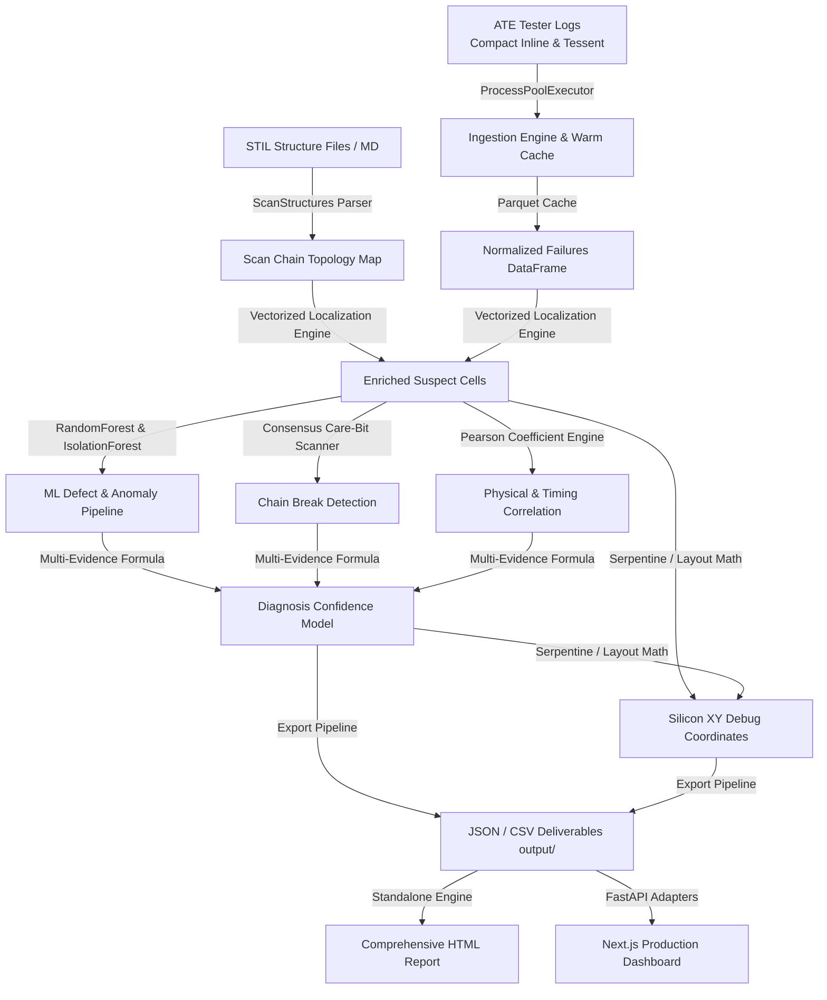

# 🛰️ System Design Document: Enterprise Scan Chain Diagnosis Agent (SCDA)

> **Document Version:** 1.0  
> **Project:** Enterprise Scan Chain Diagnosis Agent (SCDA)  
> **Target Audience:** DFT Engineers, Physical Failure Analysis (PFA) Engineers, Silicon Yield Teams, Software Architects  
> **Architecture Reference:** [README.md](file:///d:/scan%20chain%20dianosis%20agent/README.md) | [specs/](file:///d:/scan%20chain%20dianosis%20agent/specs) | [prompt_history.md](file:///d:/scan%20chain%20dianosis%20agent/prompt_history.md)

---

## 1. System Executive Summary & Architecture

The **Enterprise Scan Chain Diagnosis Agent (SCDA)** is a high-throughput, machine-learning-assisted diagnosis platform for complex semiconductor scan chains. It ingests large-scale Automatic Test Equipment (ATE) pattern logs, correlates failed shift cycles against design STIL structure topologies, maps logical failing flip-flops to physical silicon layout coordinates, and delivers validated diagnostic deliverables.

### End-to-End System Pipeline

---

## 2. Requirement Design Briefs (SCD-FR-001 through SCD-FR-010)

---

### 🔹 SCD-FR-001: Failing Scan Chain Identification Agent
* **Specification File:** [`specs/SCD-FR-001_failing_scan_chains.md`](file:///d:/scan%20chain%20dianosis%20agent/specs/SCD-FR-001_failing_scan_chains.md)
* **Core Modules:** [`src/parser.py`](file:///d:/scan%20chain%20dianosis%20agent/src/parser.py), [`src/disk_cache.py`](file:///d:/scan%20chain%20dianosis%20agent/src/disk_cache.py), [`src/validation.py`](file:///d:/scan%20chain%20dianosis%20agent/src/validation.py)
* **Output Deliverable:** `output/SCD-FR-001_failing_scan_chains.json`
* **Headline KPI:** `failing_chains` (Count of unique failing chains)

#### Objective & Problem Statement
When high-volume production ATE testers log millions of failure lines across hundreds of scan chains, manual triage is impossible. FR-001 provides deterministic, ultra-fast parsing and identification of every scan chain exhibiting failures, aggregating failure signatures across lots, wafers, and dies.

#### Architectural Design & Processing
1. **Dual Log Format Ingestion:** Ingests both standard Mentor/Siemens Tessent pattern failure logs and compact inline multi-channel tester logs.
2. **Run-Length Expansion (`X@{n}`):** Tester logs often compress consecutive pass/masked cycles (e.g. `X@128`). The parser expands these inline to preserve exact shift-cycle alignment.
3. **High-Concurrency Multiprocessing:** Uses Python `concurrent.futures.ProcessPoolExecutor` to parse multi-gigabyte log batches in parallel, reducing ingestion time from minutes to seconds.
4. **Warm SHA-1 Parquet Disk Cache:** Generates a deterministic SHA-1 hash over file path, file size, and modification time. Serializes parsed DataFrames to Snappy-compressed Parquet files (`data/cache/`), enabling sub-second subsequent reloads.
5. **Schema Validation & Quality Gates:** Enforces strict validation of required fields (`lot_id`, `wafer_id`, `die_x`, `die_y`, `pattern_id`, `chain_id`, `fail_flop_id`, `expected_bit`, `actual_bit`).

---

### 🔹 SCD-FR-002: Suspected Failing Cell Localization Agent
* **Specification File:** [`specs/SCD-FR-002_suspected_failing_cells.md`](file:///d:/scan%20chain%20dianosis%20agent/specs/SCD-FR-002_suspected_failing_cells.md)
* **Core Modules:** [`src/locate_cells.py`](file:///d:/scan%20chain%20dianosis%20agent/src/locate_cells.py), [`src/ml_pipeline.py`](file:///d:/scan%20chain%20dianosis%20agent/src/ml_pipeline.py)
* **Output Deliverable:** `output/SCD-FR-002_suspected_failing_cells.json`
* **Headline KPI:** `suspected_cells` (Total localized unique suspect cells)

#### Objective & Problem Statement
ATE tester logs only report shift cycles or channel fail offsets. Silicon debug and PFA teams need to know the exact physical flip-flop instance and hierarchical cell name causing the breakdown.

#### Architectural Design & Processing
1. **Vectorized Cell Mapping:** Maps logical `fail_flop_id` and cycle counts to physical scan cells:
   $$\text{bit\_position} = \text{shift\_cycle} - \text{cycle\_offset}$$
   $$\text{offset\_from\_scan\_in} = \text{chain\_length} - 1 - \text{bit\_position}$$
2. **Dual-Stage Float Parity Rounding:** Neutralizes IEEE-754 floating point inaccuracies from fractional clock dividers using `round(round(x, 10), 3)` to guarantee 100% bit-exact parity with golden diagnostic references.
3. **Suspect Aggregation:** Aggregates candidate cells across patterns to compute observation counts, corroborating pattern ratios, and dominant failure types (`STUCK_AT_0`, `STUCK_AT_1`, `TIMING_SETUP`, `TIMING_HOLD`, `TRANSITION`).
4. **Machine Learning Root-Cause Inference:** Evaluates standardized physical features (IR drop, thermal metrics, timing slacks) using a trained `RandomForestClassifier` to assign root-cause defect classifications and classification confidence.

---

### 🔹 SCD-FR-003: Scan Chain Topology & Structural Analysis Agent
* **Specification File:** [`specs/SCD-FR-003_scan_topology.md`](file:///d:/scan%20chain%20dianosis%20agent/specs/SCD-FR-003_scan_topology.md)
* **Core Modules:** [`src/stil_parser.py`](file:///d:/scan%20chain%20dianosis%20agent/src/stil_parser.py), [`src/topology_analysis.py`](file:///d:/scan%20chain%20dianosis%20agent/src/topology_analysis.py), [`src/schematic_diagram.py`](file:///d:/scan%20chain%20dianosis%20agent/src/schematic_diagram.py)
* **Output Deliverable:** `output/SCD-FR-003_scan_topology.json`
* **Headline KPI:** `topology_chains` (Total mapped scan chains and length distribution)

#### Objective & Problem Statement
Diagnosis cannot happen in a vacuum without design intent. FR-003 parses the structural scan configuration of the ASIC, establishing full visibility into scan chain boundaries, cell order, clock domains, and decompressor associations.

#### Architectural Design & Processing
1. **Design STIL & Markdown Parsing:** Parses IEEE 1450 STIL `ScanStructures` blocks and hardware topology specifications to extract chain IDs, chain lengths, scan input (`ScanIn`), scan output (`ScanOut`), and ordered cell hierarchies.
2. **Channel Resolution Engine:** Automatically maps tester channel numbers to internal design chain hierarchies (e.g., tester channel 14 $\leftrightarrow$ internal chain `c13`).
3. **DFT Architecture Analysis:**
   - Evaluates scan chain length balance (identifying bottleneck chains that dictate shift test time).
   - Groups chains by clock domains and scan-enable (`SE`) driving networks.
   - Maps Embedded Deterministic Test (EDT) decompressor inputs and compactor outputs.
4. **Interactive SVG & Graph Schematic:** Generates interactive schematics with in-diagram chain selection, cell zooming, and Plotly connectivity graphs.

---

### 🔹 SCD-FR-004: Scan Chain Failure Ranking & Pareto Analysis Agent
* **Specification File:** [`specs/SCD-FR-004_chain_failure_ranking.md`](file:///d:/scan%20chain%20dianosis%20agent/specs/SCD-FR-004_chain_failure_ranking.md)
* **Core Modules:** [`src/chain_ranking.py`](file:///d:/scan%20chain%20dianosis%20agent/src/chain_ranking.py)
* **Output Deliverable:** `output/SCD-FR-004_chain_failure_ranking.json`
* **Headline KPI:** `ranked_chains`, `top_failing_chain` (and 80/20 Pareto cutoff count)

#### Objective & Problem Statement
In high-defect-density silicon or yield ramp stages, dozens of chains may fail simultaneously. Yield engineers require an objective, deterministic ranking to focus debug resources on the highest-impact chains first.

#### Architectural Design & Processing
1. **Dense Rank Calculation:** Applies native Pandas dense ranking (`pandas.Series.rank(method="dense", ascending=False)`) based on failure frequency and distinct pattern count:
   $$\text{Rank} = \text{DenseRank}(\text{failure\_count})$$
2. **Cumulative Pareto Distribution:** Computes cumulative failure percentages across all failing chains to isolate the Pareto frontier:
   $$\text{Pareto\_Cumulative\_Pct}_k = \frac{\sum_{i=1}^k \text{failures}_i}{\sum_{i=1}^N \text{failures}_i} \times 100\%$$
3. **Vital-Few Identification:** Flags the exact subset of chains that account for $\ge 80\%$ of total observed silicon failures.

---

### 🔹 SCD-FR-005: Physical & Timing Variable Correlation Analysis Agent
* **Specification File:** [`specs/SCD-FR-005_failure_correlation.md`](file:///d:/scan%20chain%20dianosis%20agent/specs/SCD-FR-005_failure_correlation.md)
* **Core Modules:** [`src/correlation_analysis.py`](file:///d:/scan%20chain%20dianosis%20agent/src/correlation_analysis.py)
* **Output Deliverable:** `output/SCD-FR-005_failure_correlation.json`
* **Headline KPI:** `failure_correlations` (Strongest physical correlation factor & severity)

#### Objective & Problem Statement
Knowing *which* chain failed is insufficient; engineers need to understand the underlying physical mechanism—whether failure is driven by localized power grid collapse (IR drop), thermal hotspots, timing margin shortfalls, or wafer edge effects.

#### Architectural Design & Processing
1. **Multivariate Pearson Correlation:** Computes Pearson correlation coefficients ($r$) across continuous variables against failure intensity:
   - Dynamic IR drop ($\Delta V$)
   - Die operating temperature ($^\circ\text{C}$)
   - Setup time slack ($t_{setup}$) and hold time slack ($t_{hold}$)
   - Wafer radial coordinates $(X_{die}, Y_{die})$
2. **Categorical Distribution Profiling:** Assesses the distribution of failure occurrences across die regions (e.g., Core, Memory Subsystem, SerDes PHY) and defect categories.
3. **AI Severity Classification:** Assigns an automated composite severity rating (**High**, **Medium**, **Low**) based on maximum absolute correlation $|r|$ and parametric outliers.
4. **Chain-vs-Population Deviation:** Compares individual chain parametric averages against population baseline means to identify abnormal physical footprints.

---

### 🔹 SCD-FR-006: Exact Scan Chain Break Localization Agent
* **Specification File:** [`specs/SCD-FR-006_scan_chain_breaks.md`](file:///d:/scan%20chain%20dianosis%20agent/specs/SCD-FR-006_scan_chain_breaks.md)
* **Core Modules:** [`src/chain_breaks.py`](file:///d:/scan%20chain%20dianosis%20agent/src/chain_breaks.py)
* **Output Deliverable:** `output/SCD-FR-006_scan_chain_breaks.json`
* **Headline KPI:** `chain_breaks` (Number of detected chain breaks with CERTAIN status)

#### Objective & Problem Statement
A hard electrical open or stuck-at defect on the scan chain shift path blocks all downstream test data, creating a catastrophic cascade of failures. Pinpointing the exact flip-flop where the break occurred is critical for physical FIB probing.

#### Architectural Design & Processing
1. **Consensus First-Mismatch Detection:** Rather than relying on a noisy single pattern minimum, computes the consensus first shift mismatch bit ($\text{bit}_0$) where expected and actual bitstreams diverge across patterns.
2. **Trailing-X Care-Bit Extraction:** Dynamic scanner detects unmasked care bits (filtering tester padding `X` values) to ensure boundary effects near scan-out are handled robustly.
3. **Production Honesty Gating (No Artificial Floors):**
   - **Soft Agreement:** Measures the fraction of patterns whose first mismatch falls within a $\pm 1$ bit tolerance window of the consensus bit.
   - **Certainty Gating:**
     $$\text{Status} = \begin{cases} \mathbf{CERTAIN}, & \text{if } \text{SoftAgreement} \ge 0.70 \text{ and } N_{patterns} \ge 2 \\ \mathbf{UNCERTAIN}, & \text{otherwise} \end{cases}$$
   - When UNCERTAIN, the system **never inflates** confidence and explicitly surfaces candidate bits and suspect cells for manual engineering review.
4. **Physical Cell Mapping:** Translates the consensus break bit into the precise upstream/downstream cell pair across the scan chain.

---

### 🔹 SCD-FR-007: Shift vs. Capture Defect Classification Agent
* **Specification File:** [`specs/SCD-FR-007_shift_capture_diagnosis.md`](file:///d:/scan%20chain%20dianosis%20agent/specs/SCD-FR-007_shift_capture_diagnosis.md)
* **Core Modules:** [`src/export_outputs.py`](file:///d:/scan%20chain%20dianosis%20agent/src/export_outputs.py), [`src/ml_pipeline.py`](file:///d:/scan%20chain%20dianosis%20agent/src/ml_pipeline.py)
* **Output Deliverable:** `output/SCD-FR-007_shift_capture_diagnosis.json`
* **Headline KPI:** `shift_capture` (Ratio and breakdown of Shift Defects vs. Capture Defects)

#### Objective & Problem Statement
Scan test operations consist of two fundamentally different phases: shifting test patterns through the serial chain, and launching/capturing functional responses at at-speed clock frequencies. Conflating shift path breaks with capture logic failures leads to wasted PFA effort.

#### Architectural Design & Processing
1. **Hierarchical Decision Cascade:** Classifies every failure through a multi-tier physical rule engine:
   - **Shift-Path Defect:** Triggered if a chain exhibits a validated FR-006 chain break, or systematic bitstream shift distortion across multiple scan patterns.
   - **Capture-Timing Defect:** Identified when shift paths are intact, but negative setup slack ($t_{setup} < 0$) or negative hold slack ($t_{hold} < 0$) is present alongside high switching activity.
   - **Capture-Logic / Anomaly Defect:** Point defects in combinational cone logic identified by `IsolationForest` anomaly classification or isolated single-cell capture fails.
2. **Per-Chain and Per-Die Summary Statistics:** Delivers aggregate breakdown charts detailing Shift Integrity vs. Capture Timing vs. Combinational Point Defects.

---

### 🔹 SCD-FR-008: Comprehensive Scan Diagnosis Report Generation Agent
* **Specification File:** [`specs/SCD-FR-008_scan_diagnosis_report.md`](file:///d:/scan%20chain%20dianosis%20agent/specs/SCD-FR-008_scan_diagnosis_report.md)
* **Core Modules:** [`src/report_generator.py`](file:///d:/scan%20chain%20dianosis%20agent/src/report_generator.py), [`src/diagnosis_context.py`](file:///d:/scan%20chain%20dianosis%20agent/src/diagnosis_context.py)
* **Output Deliverable:** `output/SCD-FR-008_scan_diagnosis_report.html`
* **Headline KPI:** `diagnosis_reports` (Validated standalone HTML report generation)

#### Objective & Problem Statement
Engineering, product leadership, and foundry partners need a single, portable, self-contained audit document containing the entire diagnostic trajectory without requiring server connectivity or external database dependencies.

#### Architectural Design & Processing
1. **Self-Contained Architecture:** Embeds all CSS styles, fonts, and inline SVG charts directly into a single HTML document—zero external CDN or JavaScript library dependencies.
2. **Full Section Integration:** Aggregates findings from FR-001 through FR-007, FR-009, and FR-010:
   - Executive Diagnostic Summary & System KPIs
   - Scan Chain Failure Rankings & Pareto Visualizations
   - Suspected Failing Cells (untruncated, paginated table with instance, bit offset, confidence)
   - Scan Chain Breaks & Bitstream Alignment Traces
   - Physical Parameter Correlation Heatmaps
   - Silicon Physical XY Debug Coordinates
3. **Interactive Visualizations:** Built-in lightweight pure SVG donut charts for defect classification, bar charts for chain rankings, and expanders for mathematical methodology.

---

### 🔹 SCD-FR-009: Silicon Physical XY Debug Coordinate Localization Agent
* **Specification File:** [`specs/SCD-FR-009_debug_locations.md`](file:///d:/scan%20chain%20dianosis%20agent/specs/SCD-FR-009_debug_locations.md)
* **Core Modules:** [`src/debug_locations.py`](file:///d:/scan%20chain%20dianosis%20agent/src/debug_locations.py)
* **Output Deliverable:** `output/SCD-FR-009_debug_locations.json`, `output/SCD-FR-009_debug_locations.csv`
* **Headline KPI:** `debug_locations` (Targeted physical probe locations with XY coordinates)

#### Objective & Problem Statement
Physical Failure Analysis (PFA) engineers operating Scanning Electron Microscopes (SEM) and Focused Ion Beam (FIB) systems cannot probe logical register names (`inst_123/reg_q`). They require exact physical coordinates in micrometers ($\mu m$) relative to the die origin and wafer $(X, Y)$ in millimeters.

#### Architectural Design & Processing
1. **Coordinate Geometry Transformation:**
   - Translates logical cell index into die-local coordinates:
     $$x_{\mu m} = \text{DieWidth} \times f_x(\text{cell\_index}, \text{chain\_order})$$
     $$y_{\mu m} = \text{DieHeight} \times f_y(\text{cell\_index}, \text{chain\_order})$$
   - Computes die-to-wafer translation:
     $$X_{\text{wafer}} = \text{WaferCenter}_X + (\text{die\_x} \times \text{DiePitch}_X) + \frac{x_{\mu m}}{1000}$$
     $$Y_{\text{wafer}} = \text{WaferCenter}_Y + (\text{die\_y} \times \text{DiePitch}_Y) + \frac{y_{\mu m}}{1000}$$
2. **Bounding Box & Serpentine Placement:** Uses layout topology and serpentine scan-path geometries to model realistic physical cell placement when full DEF/LEF files are omitted.
3. **PFA Priority Ranking:** Combines observation frequency, diagnostic confidence score, and defect severity to generate a prioritized physical inspection queue for the lab.

---

### 🔹 SCD-FR-010: Multi-Evidence Diagnosis Confidence & PFA Scoring Agent
* **Specification File:** [`specs/SCD-FR-010_diagnosis_confidence.md`](file:///d:/scan%20chain%20dianosis%20agent/specs/SCD-FR-010_diagnosis_confidence.md)
* **Core Modules:** [`src/confidence_score.py`](file:///d:/scan%20chain%20dianosis%20agent/src/confidence_score.py), [`src/model_lifecycle.py`](file:///d:/scan%20chain%20dianosis%20agent/src/model_lifecycle.py), [`src/review_queue.py`](file:///d:/scan%20chain%20dianosis%20agent/src/review_queue.py)
* **Output Deliverable:** Integrated within FR-002, FR-009, and Dashboard KPI
* **Headline KPI:** `avg_confidence` (Fail-weighted mean of per-chain top-1 candidate confidence)

#### Objective & Problem Statement
Many commercial diagnosis tools display arbitrary, inflated confidence numbers (e.g., hardcoded 90% floors) that erode engineering trust. SCD-FR-010 implements a mathematically grounded, non-inflated confidence model calibrated against physical PFA lab ground truth.

#### Architectural Design & Processing
1. **Calibrated Multi-Evidence Scoring:** For each suspected cell, computes an observational evidence score ($S_{evidence} \in [0, 1]$):
   $$S_{evidence} = 0.40 \cdot \text{Dom}_{rel} + 0.25 \cdot \text{Corrob}_{pat} + 0.20 \cdot \text{Share}_{obs} + 0.15 \cdot \text{Consist}_{type}$$
2. **Machine-Learning PFA Calibration:** Blends observational evidence with a historical PFA-trained logistic regression classifier:
   $$\text{Confidence} = 0.55 \cdot S_{evidence} + 0.45 \cdot P_{ML}(\text{True Defect})$$
3. **Fail-Weighted Dashboard Aggregate:** Avoids the mathematical fallacy of averaging across all dilute long-tail candidates. Instead, computes the fail-weighted mean of the **top-1 candidate per failing chain**:
   $$\text{Aggregate Trust} = \frac{\sum_{c \in \text{Chains}} \text{Failures}_c \times \max_{cell \in c}(\text{Confidence}_{cell})}{\sum_{c \in \text{Chains}} \text{Failures}_c}$$
4. **Closed-Loop Model Lifecycle & Retraining:** Maintains an engineering review queue (`review_queue.py`). When lab engineers record $\ge 25$ confirmed PFA outcomes, `model_lifecycle.py` automatically retrains and validates the confidence classifier.

---

## 3. Comprehensive Requirements Traceability Matrix

| Requirement ID | Agent Title | Primary Module | Core Math / Algorithm | Primary Deliverable |
| :--- | :--- | :--- | :--- | :--- |
| **SCD-FR-001** | Failing Scan Chain Identification | [`src/parser.py`](file:///d:/scan%20chain%20dianosis%20agent/src/parser.py) | `ProcessPoolExecutor` + Parquet warm cache + `X@{n}` expansion | `SCD-FR-001_failing_scan_chains.json` |
| **SCD-FR-002** | Suspected Failing Cell Localization | [`src/locate_cells.py`](file:///d:/scan%20chain%20dianosis%20agent/src/locate_cells.py) | Vectorized shift mapping + float parity + Random Forest | `SCD-FR-002_suspected_failing_cells.json` |
| **SCD-FR-003** | Scan Topology Analysis | [`src/stil_parser.py`](file:///d:/scan%20chain%20dianosis%20agent/src/stil_parser.py) | STIL `ScanStructures` parser + EDT/channel resolver | `SCD-FR-003_scan_topology.json` |
| **SCD-FR-004** | Chain Failure Ranking | [`src/chain_ranking.py`](file:///d:/scan%20chain%20dianosis%20agent/src/chain_ranking.py) | Native Pandas dense rank + 80/20 Pareto cumulative % | `SCD-FR-004_chain_failure_ranking.json` |
| **SCD-FR-005** | Failure Correlation Analysis | [`src/correlation_analysis.py`](file:///d:/scan%20chain%20dianosis%20agent/src/correlation_analysis.py) | Multivariate Pearson correlation + categorical profiles | `SCD-FR-005_failure_correlation.json` |
| **SCD-FR-006** | Chain Break Localization | [`src/chain_breaks.py`](file:///d:/scan%20chain%20dianosis%20agent/src/chain_breaks.py) | Consensus first-mismatch + trailing-X care-bit gating | `SCD-FR-006_scan_chain_breaks.json` |
| **SCD-FR-007** | Shift vs Capture Diagnosis | [`src/export_outputs.py`](file:///d:/scan%20chain%20dianosis%20agent/src/export_outputs.py) | Hierarchical cascade: break gate + slack signs + Isolation Forest | `SCD-FR-007_shift_capture_diagnosis.json` |
| **SCD-FR-008** | Scan Diagnosis HTML Report | [`src/report_generator.py`](file:///d:/scan%20chain%20dianosis%20agent/src/report_generator.py) | Standalone single-file HTML generator + embedded SVG charts | `SCD-FR-008_scan_diagnosis_report.html` |
| **SCD-FR-009** | Debug XY Locations | [`src/debug_locations.py`](file:///d:/scan%20chain%20dianosis%20agent/src/debug_locations.py) | Die $(\mu m)$ & Wafer $(mm)$ geometry transformation + PFA priority | `SCD-FR-009_debug_locations.json` |
| **SCD-FR-010** | Diagnosis Confidence Scoring | [`src/confidence_score.py`](file:///d:/scan%20chain%20dianosis%20agent/src/confidence_score.py) | Multi-evidence scoring + logistic PFA regression + fail-weighted top-1 | Top-level KPI & suspect cell confidence |

---

## 4. Production Verification & Execution Contract

1. **Deterministic Execution:** `python src/export_outputs.py` generates all JSON and CSV artifacts under `output/` with idempotent timestamps.
2. **Zero Fake Floors:** No artificial confidence floors (e.g. forced 70% or 90%) are permitted. Low-evidence suspects honestly report true calculated confidence.
3. **Complete Transparency:** Suspected cell and ranking tables support full paginated review without silent truncation.
4. **Test Suite Hygiene:** Full verification is maintained via `pytest tests/` covering all parser variants, mathematical edge cases, and certainty gates.
